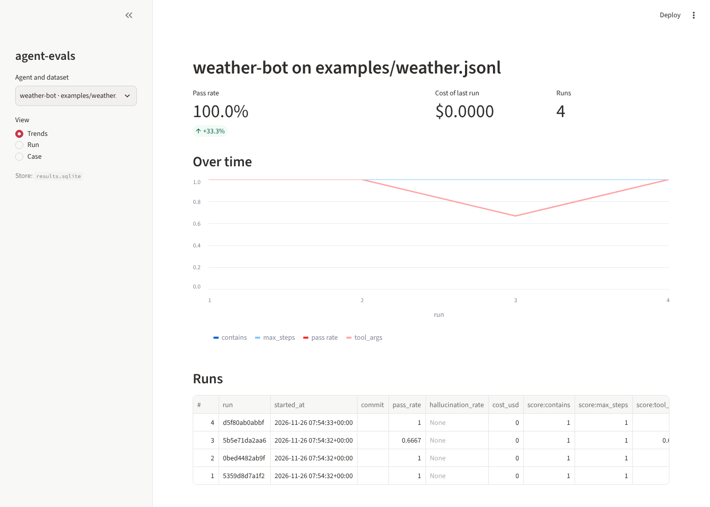

# agent-evals

Regression tests for AI agents.

Agents break quietly. Someone tweaks a prompt or switches the model, and the agent starts calling the wrong tool, passing the wrong arguments, or answering confidently from nothing. Unit tests don't catch it because the code didn't change, and the first people to notice are usually users.

I'm building agent-evals to be something like pytest for agents. You write test cases (an input plus what a good answer and a good trajectory look like), run your agent over them in CI, and get a failing build when accuracy, tool use, groundedness or cost gets worse than the last good run. Real production failures get turned into new test cases, so the suite grows from what actually went wrong.

## Status

Early. So far there's the package and its data models (`agent_evals/models.py`):

- a **test case** is an input plus whatever should be checked: the expected answer, the tool calls a good trajectory should make, the sources the answer must stick to, and step and cost limits
- a **trace** records what the agent did: each model call and tool call, with tokens, cost and timing
- a **run** collects the scores for every case, along with the git commit of the agent under test, so a regression can be traced to a change

Agents plug in through a small interface (`agent_evals/agents.py`): anything with a `name` and an async `run(case)` that returns the answer and its trace. There are adapters for:

- **plain functions**, sync or async. A function that takes a second argument gets a recorder for logging its tool calls
- **LangChain** runnables (agents, LangGraph graphs, chains), traced through a callback handler without changing the runnable (`pip install agent-evals[langchain]`)
- **OpenAI-style tool calling**, with any client that speaks the chat completions API, including local servers. Token counts and cost come from the API's usage numbers

Test cases live in JSONL files, one case per line (see [examples/weather.jsonl](examples/weather.jsonl)). A typo or a duplicate id fails with the file and line number. The runner runs cases concurrently, each with a timeout. A case that crashes or times out is recorded as failed, and the rest of the run carries on:

```python
from agent_evals.agents import FunctionAgent
from agent_evals.dataset import load_dataset
from agent_evals.runner import run_eval_sync


def weather_agent(question, rec):
    # a stand-in for a real agent: calls its tool for Berlin and answers
    rec.tool("get_weather", {"city": "Berlin"}, result={"temp_c": 12})
    return "It's 12°C in Berlin."


run = run_eval_sync(FunctionAgent(weather_agent), load_dataset("examples/weather.jsonl"), concurrency=4)
for case in run.cases:
    print(case.case_id, [c.name for c in case.result.trace.tool_calls], case.result.output)
```

Each `Run` records the agent, the dataset, the git commit and every trace.

### Scorers

Scoring hooks in through `scorers=[...]`. A scorer is anything that takes the case and the result and returns a `Score` (0 to 1, pass or fail, and a reason). Scorers that need something a case doesn't have, like an expected answer, skip that case. That way one list of scorers works for a whole dataset. The built-in ones, by name:

| Name | Checks | Options |
|---|---|---|
| `exact` | the answer equals `expected_output`, after normalising case, punctuation and articles | `normalized` |
| `contains` | `expected_output` appears in the answer as whole words | |
| `numeric` | every number in `expected_output` appears in the answer ("1,234.50 EUR" matches 1234.5) | `rel_tol`, `abs_tol` |
| `regex` | the answer matches a pattern, given as an option or per case in `metadata.regex` | `pattern`, `ignore_case` |
| `json_schema` | the answer contains JSON valid against a schema, given as an option or in `metadata.json_schema` (`pip install agent-evals[schema]`) | `schema` |
| `tools` | the agent called the tools in `expected_tools` (by name), in order if `tools_in_order` is set. `"expected_tools": []` means no tool should be called | `allow_extra` |
| `tool_args` | the same, and each call has the expected arguments. Only the listed arguments are checked, strings are compared case-insensitively and `"3"` matches `3`. A failure shows the closest call the agent actually made | `allow_extra`, `rel_tol`, `case_sensitive` |
| `groundedness` | the share of the answer's claims that `sources` (and, by default, the agent's own tool results) back up. Fails below `threshold` and lists the unsupported claims | `threshold`, `min_coverage`, `include_tool_results`, `checker` |
| `judge` | a model's rubric scores for the answer, see below | `model`, `rubric`, `threshold`, `samples`, `include_tools` |
| `max_steps` | no more than `max_steps` model and tool calls | `limit` (default for cases without one) |
| `max_cost` | no more than `max_cost_usd`, from the trace | `limit` |
| `max_latency` | total step time under `metadata.max_latency_ms` | `limit` |

```python
from agent_evals.scorers import build_scorers, default_scorers

scorers = build_scorers(["contains", {"name": "numeric", "rel_tol": 0.01}, "tool_args"])
run = run_eval_sync(agent, cases, scorers)

# or the defaults: contains, tool_args, max_steps and max_cost
run = run_eval_sync(agent, cases, default_scorers())
```

A failing trajectory says what went wrong. For example, `missing get_weather(city='Oslo') (closest call: get_weather(city='Lisbon'))`.

### Hallucinations

`groundedness` splits the answer into claims (sentences and list items, minus filler like "Let me know if you need anything else" and questions) and checks each one against the sources. The default checker is lexical and needs no model. A claim counts as supported when a source passage (a sentence, or two neighbouring sentences) contains most of its content words and **every** number in it. For a refund-policy source that says "Refunds are available within 30 days of purchase":

```
Refunds are available within 30 days of purchase.   supported
Refunds take 5 business days.                        unsupported (number not in sources: 5)
Refunds are available within 60 days of purchase.    unsupported (number not in sources: 60)
```

That catches the hallucinations that hurt most in agent answers: invented figures, dates, names and products. It's cheap enough to run on every commit. It doesn't understand paraphrase or contradictions phrased with the same words. For those, pass a model and claims are checked by it instead:

```python
import openai

from agent_evals.llm import OpenAIChatModel
from agent_evals.scorers import get_scorer

judge = OpenAIChatModel(openai.OpenAI(), "gpt-4o-mini")
groundedness = get_scorer("groundedness", model=judge, extract_with_model=True)
```

The model labels each claim supported, contradicted or not found, and it has to quote the passage it relied on. If the quote isn't really in that source, the claim counts as unsupported, so the checker can't make up support of its own. `extract_with_model=True` also has the model split answers into one-fact claims. "Refunds take 30 days and include shipping" is one sentence but two facts. A model is anything with `complete(prompt) -> str` (`FunctionModel` wraps a plain function), and `checker=` takes any object with a `check(claim, sources)` method.

### LLM-as-judge

Some things only a model can grade: whether an answer actually helps, or is right when it's worded differently from the reference. `judge` asks a model to score the answer on each criterion of a rubric, from 1 to 5, and passes when the weighted score (rescaled to 0 to 1) reaches `threshold`, 0.75 by default:

```python
correctness = get_scorer("judge", model=judge, rubric="correctness")
custom = get_scorer("judge", model=judge, threshold=0.8, rubric={
    "name": "support-tone",
    "criteria": [
        {"name": "empathetic", "description": "Acknowledges the customer's problem.", "weight": 2},
        {"name": "on_policy", "description": "Doesn't promise anything the refund policy doesn't allow."},
    ],
})
```

The built-in rubrics are `correctness` (uses `expected_output` as a reference when there is one), `helpfulness` and `safety`. The judge sees the question, the reference, the answer and the tool calls. If its reply can't be read, the case fails with the reason instead of passing silently. `samples=3` asks three times and averages, and the reason shows the spread, a quick way to see how noisy a judge is.

#### Can you trust the judge?

A judge is a model too, and one that passes answers a person would fail makes a broken agent look healthy. So before gating CI on a judge, run it on answers people have already labelled:

```python
from agent_evals.calibration import calibrate, load_labels

report = calibrate(correctness, load_labels("examples/judge_labels.jsonl"))
print(report.summary())
for d in report.disagreements:
    print(d.case_id, "human:", d.human_passed, "judge:", d.judge.reason)
```

The report has accuracy, Cohen's kappa (agreement beyond chance, which matters when most answers are good), the **false pass rate** (bad answers the judge let through), the false fail rate, and the mean score error when the labels include a score. `report.trustworthy()` is a rule of thumb: kappa of at least 0.6 and no more than 10% of bad answers passed. [examples/judge_labels.jsonl](examples/judge_labels.jsonl) has eight labelled refund answers to show the format. A real calibration set should be a few hundred answers from your own agent.

A new scorer is a subclass of `BaseScorer` with a `name` and a `score()` method, registered with `@register`. A scorer in another package is registered through the `agent_evals.scorers` entry point group, so it shows up by name without any change here.

### Run history

`ResultStore` keeps runs in SQLite (`.agent-evals/results.sqlite` by default). Each run's summary, its cases and every score are stored as rows, so history queries are cheap. The full run, traces included, is kept too:

```python
from agent_evals.store import ResultStore

with ResultStore() as store:
    store.save(run)
    previous = store.latest_run(run.agent, run.dataset, before=run.id)
    store.score_history("groundedness", run.agent, run.dataset)   # [(started_at, mean), ...]
    store.case_history("berlin-now", run.agent, run.dataset)      # did this case pass at each commit?
```

Runs can be looked up by an id prefix, like a short git hash. Every run records the git commit of the agent under test, so when a case starts failing, the history shows the commit where it changed.

### Command line

```bash
agent-evals run examples/weather_agent.py:agent examples/weather.jsonl
# ...
# weather_agent:agent on examples/weather.jsonl: 3/3 passed (100.0%), cost $0.0000, run 47a7cbd4c3df
#   contains       1.000  (1 cases)
#   tool_args      1.000  (3 cases)
#   max_steps      1.000  (2 cases)
```

The agent is `module:attr` or `file.py:attr`, either an `Agent` or a plain function. Scorers are picked with `-s name` (repeatable, with options as `-s numeric:rel_tol=0.01`), and the defaults are used when none are given. `-t tag` runs a subset of the cases, and `--fail-under 0.9` exits with 1 below that pass rate. Every run is saved to the results store, unless you pass `--no-save`. [examples/weather_agent.py](examples/weather_agent.py) is a toy agent for trying it out.

`agent-evals report` shows a saved run: `latest` (the default), `previous`, a run id or prefix, or a file written by `run --json`. Use `-f markdown` for a table you can drop into `$GITHUB_STEP_SUMMARY` or a PR comment, `-f json` for the full run with traces, and `--all` to include passing cases.

`agent-evals compare` is the CI gate. It compares two runs case by case, the previous and latest by default, and exits with 1 when a case that used to pass now fails. A pass rate alone can hide that: fix two cases, break two others, and it doesn't move.

```bash
# the example agent, then a version that answers the Lisbon/Oslo question without checking the weather
agent-evals compare --max-score-drop 0.05 --max-cost-increase 0.2
# c13b6e293555 -> ebf7ace2841f: pass rate 100.0% -> 66.7% (-33.3%), cost $0.0000 -> $0.0000
#   tool_args      1.000 -> 0.667  -0.333
#   max_steps      1.000 -> 1.000
#   contains       1.000 -> 1.000
#   REGRESSED compare: tool_args: missing get_weather(city='Lisbon'), get_weather(city='Oslo')
# FAIL: 1 case(s) that passed before now fail; mean tool_args dropped by 0.333 (allowed 0.05)
```

`--max-regressions N` allows some newly failing cases, `--max-score-drop` fails when any scorer's average falls by more than that, and `--max-cost-increase 0.2` fails on a 20% cost rise. `-f markdown` writes the same thing as a table for the PR.

### Dashboard

```bash
pip install "agent-evals[dashboard]"
agent-evals dashboard
```

It opens a Streamlit app on the same results store, with three views:

- **Trends**: pass rate, hallucination rate (when groundedness is scored), each scorer's average and cost per run for one agent and dataset.
- **Run**: the failing cases of a run, each with why it failed, the answer, the scores and the full trace.
- **Case**: how one case did across runs and commits, with a warning when it keeps flipping between pass and fail, which usually means it's flaky rather than broken.



Runs are grouped by agent name, so use `agent-evals run -n weather-bot ...` to keep runs of different versions of an agent on the same chart.

### From production failures to test cases

The best test cases are the questions real users got bad answers to. So in production, log what went wrong to a feedback file: a thumbs-down, a user correcting the answer, or the agent crashing.

```python
from agent_evals.feedback import FeedbackLog

log = FeedbackLog("feedback.jsonl")

# a user said the answer was wrong and gave the right one
log.record("Is it colder in Berlin or Oslo?", "correction", output=answer, correction="Oslo")
# a thumbs-down, or a crash (an AgentResult with an error is logged as kind="error")
log.record_result(question, result, comment="didn't answer the question")
```

It's an append-only JSONL file, so several workers can write to it and there's no service to run. Pass `sources=` with the documents the agent was given and the new case will check groundedness too, and `expected_tools=` when a reviewer knows which tool should have been called.

Then turn the log into test cases:

```bash
agent-evals feedback examples/feedback.jsonl --into examples/weather.jsonl
# 5 feedback record(s), 3 new input(s)
#   1 skipped, already covered by examples/weather.jsonl or the drafts
#   ready: added 2 to examples/weather.jsonl
#     fb-db7397dcb7  x1  Is it colder in Berlin or Oslo?
#     fb-5123838eeb  x1  What's the weather in Munich?
#   drafts: added 1 to examples/weather.drafts.jsonl
#     fb-6b6d28a906  x2  Will it rain in Lisbon tomorrow?
```

Reports of the same question (ignoring case and punctuation) become one case, and `x2` is how many times it came up, so the most common problems are at the top. A correction says what the right answer is, so it becomes a case straight away. A thumbs-down only says the answer was wrong, so it goes to a drafts file until someone writes down what a good answer looks like. Questions the dataset already has are skipped, and so are drafts nobody has finished yet, so running it every day is safe. Each case keeps the bad answer, the comment and when it was first reported in its `metadata`.

With the two new cases, the example agent drops to 4/5: it never looks up the weather for Munich, because it only knows three cities.

## Development

```bash
python -m venv .venv && source .venv/bin/activate
pip install -e ".[dev]"
pre-commit install          # ruff and a few file checks on every commit
pytest
```

CI runs ruff, mypy (strict) and the tests on Python 3.10 to 3.13 for every push and pull request.

## License

MIT
